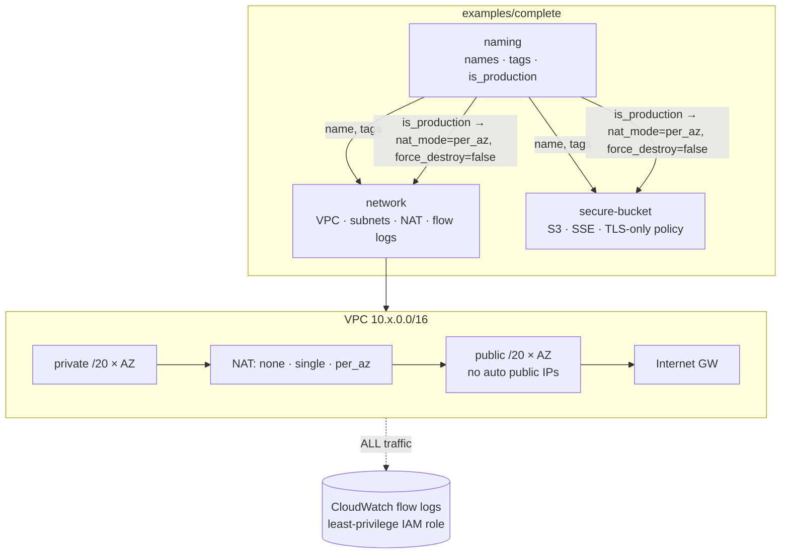
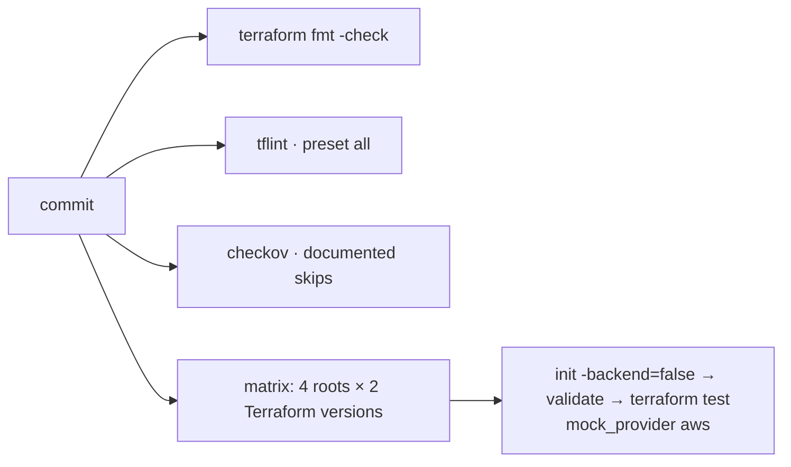

# terraform-modules

[](https://github.com/HOFFMAN-ALTERNATIVE/terraform-modules/actions/workflows/ci.yml)


Three AWS modules (naming, network, secure S3 bucket) with secure defaults, tested on every commit without a cloud account. Native `terraform test` runs against mocked providers: 28 test runs across the modules and a full example, on Terraform 1.9 and 1.12, plus tflint and a Checkov scan (79 checks pass, 7 skipped on purpose and explained below). No credentials, no cost.

The trade-off: mocked providers prove layout, policy and input validation, not that AWS accepts the plan. A real-account smoke test belongs in a separate, gated pipeline.

## Architecture





## Modules

| Module | What it gives you | Secure / sane defaults |
|---|---|---|
| [`naming`](modules/naming) | Canonical `<ns>-<env>-<component>` names, a ≤24-char short form, governance tag map, `is_production` flag | Mandatory tags (`ManagedBy`, `Owner`, …) cannot be overridden; strict input validation |
| [`network`](modules/network) | VPC with deterministic, non-overlapping public/private `/20`s across 1–6 AZs, IGW, NAT in `none`/`single`/`per_az` mode, per-AZ private route tables | Default SG stripped of all rules, no auto-assigned public IPs, VPC flow logs (ALL) with a scoped IAM role, optional KMS key for the log group |
| [`secure-bucket`](modules/secure-bucket) | S3 bucket with encryption, versioning, lifecycle and an optional read-only grant | All public access blocked, ACLs disabled, SSE-S3 or KMS + bucket keys, deny non-TLS and TLS < 1.2, multipart cleanup, `force_destroy=false` |

## Usage

```hcl
module "naming" {
  source      = "github.com/HOFFMAN-ALTERNATIVE/terraform-modules//modules/naming?ref=v1.0.0"
  namespace   = "acme"
  environment = "prod"
  component   = "platform"
}

module "network" {
  source   = "github.com/HOFFMAN-ALTERNATIVE/terraform-modules//modules/network?ref=v1.0.0"
  name     = module.naming.name
  nat_mode = module.naming.is_production ? "per_az" : "single"
  tags     = module.naming.tags
}
```

See [`examples/complete`](examples/complete) for all three wired together.

## Testing without a cloud account

```bash
cd modules/network
terraform init -backend=false
terraform test            # 12 runs, mocked AWS provider
```

Tests cover behaviour, not just syntax: CIDR math and overlap, NAT topology per mode (single NAT shared vs. zonal
NAT per route table), flow-log scoping, public-access blocks, encryption switching to KMS with bucket keys,
TLS-only bucket policy statements, lifecycle rules following inputs, and `expect_failures` for every validation rule.
**28 runs** in total, executed in CI on Terraform 1.9 and 1.12.

## Design decisions

- [ADR 0001](docs/adr/0001-mocked-providers-for-tests.md): mocked providers instead of a sandbox
  account. Deterministic, credential-free tests; real-cloud checks belong in a separate gated pipeline.
- [ADR 0002](docs/adr/0002-explicit-nat-mode.md): NAT cost is explicit. `nat_mode` is `none`,
  `single` or `per_az`, and the example derives it from the environment.
- [ADR 0003](docs/adr/0003-count-with-deterministic-cidrs.md): `count` with a fixed CIDR layout,
  so plans stay readable in review. The cost is replacement when AZs or `subnet_newbits` change.

## Skipped Checkov checks

| Check | Why it is skipped |
|---|---|
| CKV_AWS_18 S3 access logging | Needs a separate log bucket; wire it to your logging account |
| CKV_AWS_144 cross-region replication | Doubles storage cost; not a default for every bucket |
| CKV2_AWS_62 S3 event notifications | Application-specific |
| CKV_AWS_300 abort failed uploads | False positive: the first lifecycle rule always aborts incomplete uploads after 7 days |
| CKV_AWS_338 one-year log retention | Retention is a variable (default 30 days); a year is a compliance decision |
| CKV_AWS_158 KMS for flow logs | Opt-in through `flow_logs_kms_key_arn`, because the key policy is yours |
| CKV_AWS_394 pinned AZ identity | The module takes the first `az_count` available zones; pin zones yourself if an AZ outage shifting the list matters |

## Limits

- AWS only, provider 5.x to 6.x.
- No module for compute, databases or IAM beyond the flow-log role.
- IPv4 only; subnets are fixed `/20`s by default (`subnet_newbits`).
- Tests do not call AWS, so provider-side errors (quotas, SCPs, region quirks) only show up on a real apply.

Security notes: [SECURITY.md](SECURITY.md).

## License

MIT
