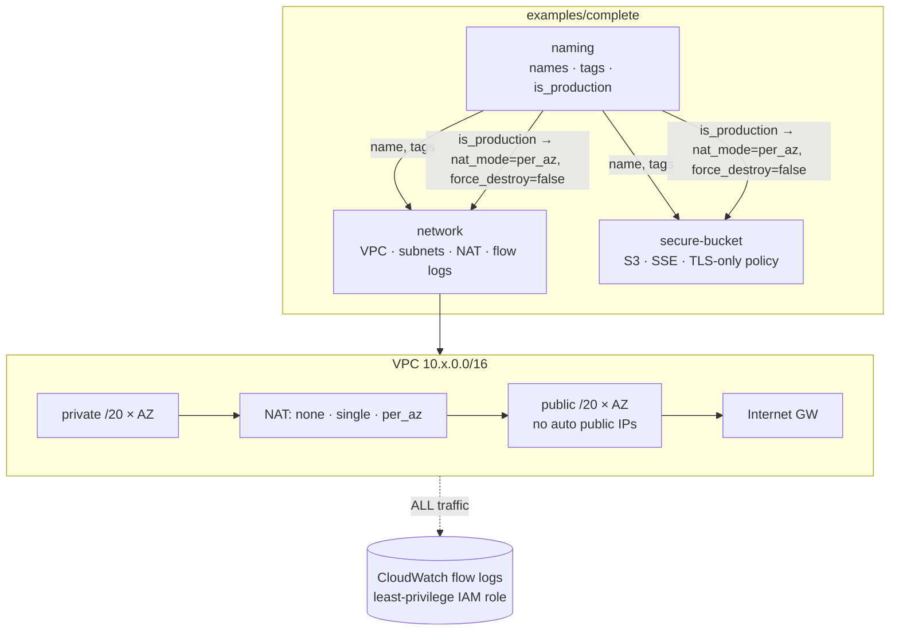
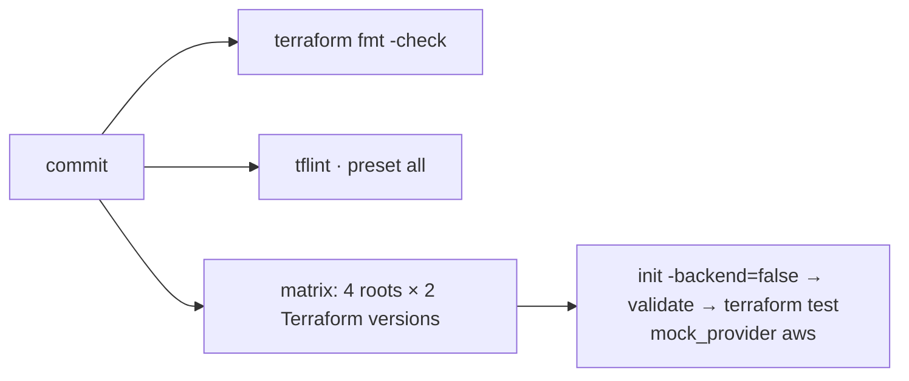

# terraform-modules

[](https://github.com/HOFFMAN-ALTERNATIVE/terraform-modules/actions/workflows/ci.yml)


Reusable, opinionated Terraform modules with **secure defaults** and a **test suite that needs no cloud account**:
every module is exercised by native `terraform test` against **mocked providers**, so CI proves layout,
security posture and input validation on every commit — no credentials, no cost, no flakiness.

Designed and maintained solo as a production baseline: the boring, correct defaults I'd want in any AWS estate.

## Architecture





## Modules

| Module | What it gives you | Secure / sane defaults |
|---|---|---|
| [`naming`](modules/naming) | Canonical `<ns>-<env>-<component>` names, a ≤24-char short form, governance tag map, `is_production` flag | Mandatory tags (`ManagedBy`, `Owner`, …) cannot be overridden; strict input validation |
| [`network`](modules/network) | VPC with deterministic, non-overlapping public/private `/20`s across 1–6 AZs, IGW, NAT in `none`/`single`/`per_az` mode, per-AZ private route tables | Default SG stripped of all rules, no auto-assigned public IPs, VPC flow logs (ALL) with a scoped IAM role |
| [`secure-bucket`](modules/secure-bucket) | S3 bucket with encryption, versioning, lifecycle and an optional read-only grant | All public access blocked, ACLs disabled, SSE-S3 or KMS + bucket keys, deny non-TLS and TLS < 1.2, multipart cleanup, `force_destroy=false` |

## Usage

```hcl
module "naming" {
  source      = "github.com/HOFFMAN-ALTERNATIVE/terraform-modules//modules/naming?ref=v1.0.0"
  namespace   = "acme"
  environment = "prod"
  component   = "platform"
}

module "network" {
  source   = "github.com/HOFFMAN-ALTERNATIVE/terraform-modules//modules/network?ref=v1.0.0"
  name     = module.naming.name
  nat_mode = module.naming.is_production ? "per_az" : "single"
  tags     = module.naming.tags
}
```

See [`examples/complete`](examples/complete) for all three wired together.

## Testing without a cloud account

```bash
cd modules/network
terraform init -backend=false
terraform test            # 10 runs, mocked AWS provider, ~10 s
```

Tests cover behaviour, not just syntax: CIDR math and overlap, NAT topology per mode (single NAT shared vs. zonal
NAT per route table), flow-log scoping, public-access blocks, encryption switching to KMS with bucket keys,
TLS-only bucket policy statements, lifecycle rules following inputs, and `expect_failures` for every validation rule.
**26 runs** in total, executed in CI on Terraform 1.9 and 1.12.

## Design decisions

- **Mocks over sandboxes** — `mock_provider` gives deterministic, credential-free tests; real-cloud smoke tests
  belong in a separate, gated pipeline.
- **Cost-aware HA** — NAT gateways are the classic surprise bill; the mode is explicit and driven by environment.
- **Explicit over clever** — `count` with stable indices and documented CIDR layout so plans stay readable in review.

## License

MIT © Herman Hoffman
